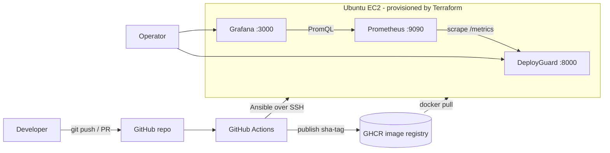
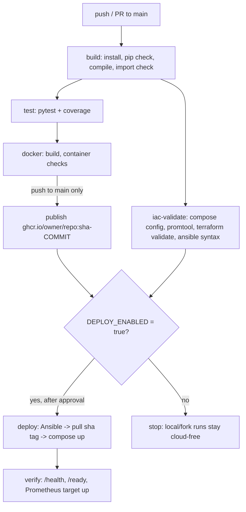

# DeployGuard — Automated CI/CD and Deployment Monitoring Platform

> PEC 4 – DevOps · Formative Assessment 2 (FA 2) · Student: `<NAME>` · Roll/PRN: `<ROLL>` · Section: `<SECTION>` · Guide: `<FACULTY NAME>` · Date: `<DATE>`

## 1. Abstract
DeployGuard is a small FastAPI service plus the complete automation around it: GitHub Actions builds and tests every change, packages it as a Docker image, publishes an immutable image to GHCR, deploys it to an Ubuntu EC2 host with Ansible (infrastructure created with Terraform), and monitors it with Prometheus and Grafana. The whole stack also runs locally with one `docker compose up` command, so the demonstration does not depend on paid cloud services.

## 2. Problem statement
Manual deployments cause configuration errors, inconsistent environments, failed releases and slow detection of failures. DeployGuard shows how an automated delivery pipeline validates code, builds, tests, containerizes, deploys and monitors an application with no manual steps between a `git push` and a verified, observable release.

## 3. Objectives
1. Automate build and test on every push/PR (GitHub Actions + pytest).
2. Package the app reproducibly (Docker, non-root, health-checked).
3. Deploy only after validation, using an immutable image tag (Ansible + Compose).
4. Provision infrastructure as code (Terraform), never automatically applied.
5. Observe health, traffic, errors and latency (Prometheus + Grafana) and demonstrate a controlled failure and recovery.

## 4. Scope and limitations
* **In scope:** the application, tests, Docker/Compose, CI/CD workflow, Terraform, Ansible, monitoring, documentation.
* **Honest limitations**
  * The deployment history is a *record*. Entries have a `source`: `runtime` (the process started), `simulated` (demo data, no real deployment) or `ci-cd` (reported by Ansible after a real deployment). Only `ci-cd` entries represent a real deployment, and the dashboard says so.
  * No self-healing is implemented. Docker's `restart: unless-stopped` restarts crashed containers, but a container you stop on purpose stays stopped; no alert routing (Alertmanager) is configured.
  * Single EC2 instance, single environment, HTTP only (no TLS). Add a reverse proxy/TLS for real use.
  * Tested with Python **3.12**. The assignment names Python 3.14.6; this could not be tested (see `docs/tool-selection.md`). `PYTHON_VERSION` is a build argument and CI variable so you can try it.

## 5. System requirements
| Need | Local demo | Cloud demo (optional) |
|---|---|---|
| OS | Windows/macOS/Linux | Ubuntu 24.04 EC2 (created by Terraform) |
| Software | Git, Python 3.12, Docker Desktop/Engine with Compose v2 | Terraform ≥ 1.5, Ansible, AWS CLI, an AWS account |
| Accounts | GitHub | GitHub, AWS (billing enabled) |

## 6. Technology stack and justification
| Stage | Tool | Why |
|---|---|---|
| App | FastAPI (+Jinja2, vanilla JS) | Small, typed, built-in validation, easy testing, async |
| Test | pytest + FastAPI TestClient | Standard, fast, no server needed |
| VCS | Git + GitHub | Source of truth, triggers the pipeline |
| CI/CD | GitHub Actions | Free for the repo, native GHCR/secrets/environments |
| Container | Docker + Compose | Same artifact everywhere; Compose describes the multi-service stack |
| Registry | GHCR | Free, authenticates with `GITHUB_TOKEN`, no extra account |
| IaC | Terraform | Declarative, reviewable, reproducible EC2 + security group |
| Config mgmt | Ansible | Agentless (SSH), idempotent, readable YAML |
| Metrics / dashboards | Prometheus / Grafana | De-facto open-source pair; pull-based scraping, PromQL |

Full comparison with alternatives: [`docs/tool-selection.md`](docs/tool-selection.md).

## 7. Architecture


## 8. End-to-end CI/CD flow

Job dependencies: `build → test → docker → deploy`; `build → iac-validate → deploy`. Pull requests run build/test/validate/container checks but never log in to GHCR, never push, and never deploy. Details: [`docs/pipeline.md`](docs/pipeline.md).

## 9. Repository structure
```
deployguard/
├── app/                  FastAPI app (main, config, store, metrics, templates/, static/)
├── tests/                pytest suite (19 tests)
├── .github/workflows/ci-cd.yml
├── docker/docker-compose.prod.yml   used by Ansible (pulls image, no build)
├── Dockerfile  docker-compose.yml  .env.example  requirements*.txt
├── monitoring/           prometheus.yml, alerts.yml, grafana/{provisioning,dashboards}
├── terraform/            versions/providers/variables/main/outputs, tfvars example
├── ansible/              playbook.yml, inventory.ini.example, group_vars/, templates/
├── docs/                 architecture, tool-selection, pipeline, deployment-guide,
│                         monitoring-guide, viva-questions, fa2-report, rubric-mapping,
│                         demo-plan, screenshot-checklist
└── README.md  LICENSE
```

## 10. Local setup and testing
```bash
git clone https://github.com/<your-user>/deployguard.git && cd deployguard
python3 -m venv .venv && source .venv/bin/activate      # Windows: .venv\Scripts\activate
pip install -r requirements-dev.txt
python -m pytest --cov=app                                # run the tests
uvicorn app.main:app --reload                             # http://127.0.0.1:8000
```
Verify endpoints (new terminal):
```bash
curl -i http://127.0.0.1:8000/health
curl -i http://127.0.0.1:8000/ready
curl -s http://127.0.0.1:8000/api/status
curl -s http://127.0.0.1:8000/api/deployments
curl -s http://127.0.0.1:8000/metrics | grep deployguard_
```
Record a **simulated** demo entry (only works when `DEPLOYGUARD_API_TOKEN` is set when starting the app):
```bash
curl -s -X POST http://127.0.0.1:8000/api/deployments -H "X-API-Token: $DEPLOYGUARD_API_TOKEN" \
  -H "Content-Type: application/json" \
  -d '{"version":"1.0.0","image_tag":"demo","commit_sha":"abc1234","environment":"demo","status":"success","source":"simulated","note":"demo only"}'
```

## 11. Docker and Docker Compose
```bash
cp .env.example .env            # then edit GRAFANA_ADMIN_PASSWORD (required)
docker build -t deployguard:local .
docker compose config -q        # validate
docker compose up -d --build    # app + Prometheus + Grafana
docker compose ps
docker compose logs -f deployguard
curl -fsS http://127.0.0.1:8000/health
docker compose down             # keep volumes;  add -v to also delete Prometheus/Grafana data
```
URLs: app `http://127.0.0.1:8000` · Prometheus `http://127.0.0.1:9090` · Grafana `http://127.0.0.1:3000` (user `admin`, password from `.env`). Ports are bound to `127.0.0.1` by default; ports are configurable in `.env`.

## 12. GitHub Actions and GHCR setup
1. Create a GitHub repo and push this project (`git init`, `git add .`, `git commit`, `git remote add origin …`, `git push -u origin main`). Check `git status` shows no `.env`/`*.tfvars`/`*.pem`.
2. **Settings → Actions → General → Workflow permissions:** "Read repository contents" is enough; the workflow requests `packages: write` only in the `docker` job.
3. Push to `main`: build, test, container checks and the **publish** step run. The image appears under your profile/repo **Packages** as `ghcr.io/<owner>/<repo>:sha-<commit>`.
4. Package visibility: new packages are private by default. Keep it private (deploy job logs in with `GITHUB_TOKEN`) or make it public (**Package settings → Change visibility**) so the server can pull without credentials.
5. Cloud deploy is **opt-in**. To enable, create:
   * Repository **variables:** `DEPLOY_ENABLED=true`, `AWS_REGION`, `EC2_SECURITY_GROUP_ID` (Terraform output `security_group_id`).
   * **Environment** `production` (Settings → Environments; add yourself as a required reviewer) with **secrets:** `AWS_ACCESS_KEY_ID`, `AWS_SECRET_ACCESS_KEY` (an IAM user limited to the policy in `terraform/README.md`), `EC2_HOST` (public IP), `EC2_SSH_PRIVATE_KEY`, `GRAFANA_ADMIN_PASSWORD`, optional `DEPLOYGUARD_API_TOKEN`.
   Without `DEPLOY_ENABLED`, the deploy job is skipped, so forks and local runs need no cloud credentials.

## 13. Terraform (optional AWS)
See [`terraform/README.md`](terraform/README.md) for IAM, cost and cleanup. Summary:
```bash
cd terraform && cp terraform.tfvars.example terraform.tfvars   # edit key_name and your IP /32
terraform init && terraform fmt -check && terraform validate
terraform plan -out tf.plan          # READ the plan
terraform apply tf.plan              # explicit operator action: creates billable resources
terraform destroy                    # when finished
```

## 14. Ansible deployment
See [`ansible/README.md`](ansible/README.md). Summary:
```bash
cd ansible && cp inventory.ini.example inventory.ini        # set IP + key path
ansible-galaxy collection install -r requirements.yml
export GRAFANA_ADMIN_PASSWORD='<min 8 chars>'  DEPLOYGUARD_API_TOKEN='<random>'
ansible-playbook playbook.yml -e deployguard_image=ghcr.io/<owner>/<repo>:sha-<full-commit-sha>
```

## 15. Prometheus and Grafana
Prometheus scrapes `deployguard:8000/metrics` every 5 s. Grafana auto-provisions the **DeployGuard Overview** dashboard (availability, readiness, uptime, request rate by status, 5xx error ratio, p50/p95/p99 latency, requests by path, running build). Verification steps and the controlled failure test: [`docs/monitoring-guide.md`](docs/monitoring-guide.md).

## 16. Screenshots to capture
See [`docs/screenshot-checklist.md`](docs/screenshot-checklist.md). No screenshots are included; capture your own as evidence.

## 17. Troubleshooting
| Symptom | Fix |
|---|---|
| `GRAFANA_ADMIN_PASSWORD` error on `compose up` | `cp .env.example .env` and set it |
| Port already in use | change `APP_PORT`/`PROMETHEUS_PORT`/`GRAFANA_PORT` in `.env` |
| Prometheus target DOWN | `docker compose logs deployguard`; check `docker compose ps` health |
| Grafana panels "No data" | wait 15–30 s, generate traffic (`curl /health` a few times), widen time range |
| `docker login`/pull denied on EC2 | package is private: provide `GHCR_USER`/`GHCR_TOKEN` or make it public |
| Ansible `UNREACHABLE` | key permissions (`chmod 600`), security-group SSH CIDR, correct IP |
| Workflow deploy job skipped | `DEPLOY_ENABLED` not `true`, or not a push to `main` |
| Terraform "InvalidKeyPair" | `key_name` must exist in the chosen region |

## 18. Security considerations
Secrets only in GitHub Secrets / local `.env` (git-ignored); the API never returns env vars or the token; token compared in constant time; strict input validation (422 on bad input); security headers + CSP; UI uses `textContent` (no XSS sink); container runs as non-root UID 10001 with `no-new-privileges` and all capabilities dropped; SSH restricted to one CIDR (Terraform rejects `0.0.0.0/0`); IMDSv2 required; encrypted EBS; `no_log` on secret-bearing Ansible tasks; actions use minimal `permissions`; PRs never publish or deploy. Prometheus/Grafana ports are open to your CIDR only; add TLS and stronger auth before any real use.

## 19. Cloud cost warning and cleanup
EC2 (t3.small by default), the EBS volume and the public IPv4 address are billed while they exist, even if idle. Check the AWS Pricing Calculator for your region and your free-tier status. Clean up with `terraform destroy`, then confirm in the EC2 console that no instance, volume or security group remains, and delete the IAM access keys you created for the demo. Set an AWS Budget alert.

## 20. What has and has not been verified
Verified in the build environment (Linux, Python 3.12.3, **no Docker daemon, no AWS**):
* `pytest`: 19 passed, 100 % line coverage; pinned requirements install cleanly in a fresh venv; `pip check` OK.
* Running app + a real Prometheus 2.55.1 binary: both targets `up`; **all 11 dashboard queries return data**; stopping the app → `up=0` and `DeployGuardDown` alert **firing**; restarting → `up=1`, ready=1, history preserved.
* Static validation: `promtool check config/rules`, `docker compose config` (local and prod files), `hadolint` (clean), `actionlint` (clean), `yamllint`, OpenTofu 1.8.5 `fmt -check` + HCL parse, `ansible-playbook --syntax-check`, `ansible-lint` (production profile).

**Not verified — you must run these:** `docker build`/`docker compose up` (so container health checks and Grafana provisioning/rendering), a real GitHub Actions run, GHCR publish, `terraform validate/plan/apply` (needs the AWS provider download and credentials), the Ansible run against EC2, Python 3.14.

## 21. Conclusion and future enhancements
DeployGuard demonstrates source → build → test → containerize → deploy → monitor with real automation and honest evidence. Future work: Alertmanager notifications, TLS via Caddy/Traefik, blue-green or rolling deploys with automatic rollback, OIDC-based AWS auth instead of access keys, Trivy image scanning, SBOM/signing (cosign), a remote Terraform backend, and Kubernetes as an optional extension.
